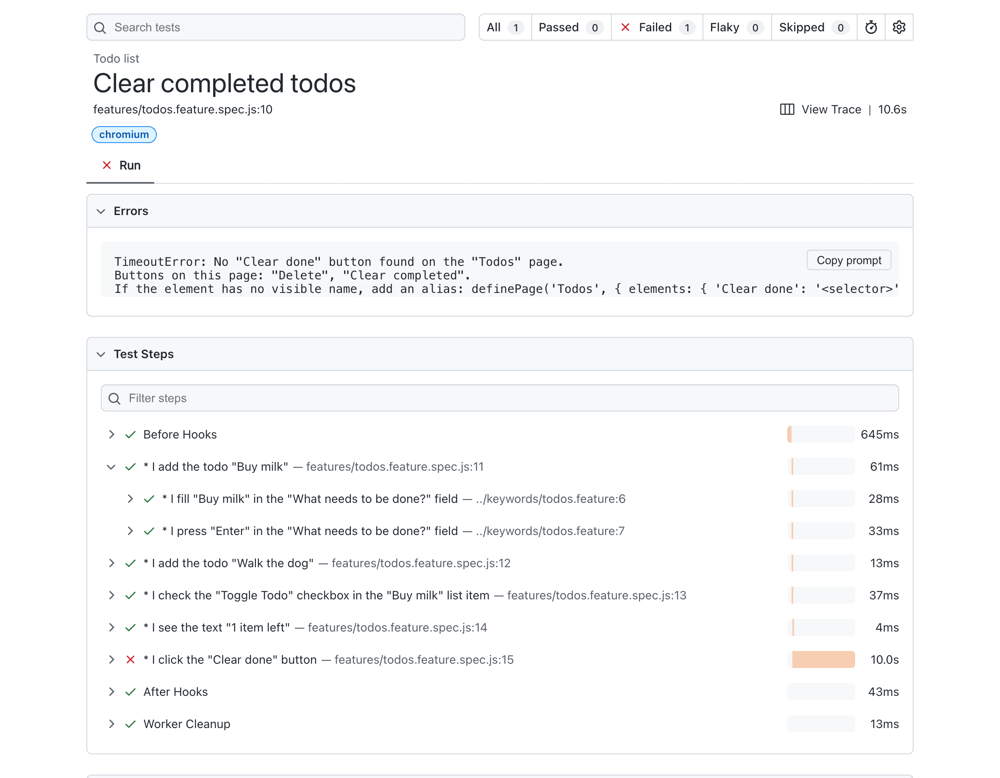

# Plainwright

[](https://github.com/nils-hoyer/plainwright/actions/workflows/ci.yml)
[](https://www.npmjs.com/package/plainwright)
[](LICENSE)

Readable, keyword-driven tests built on [Playwright](https://playwright.dev/) and
[playwright-bdd](https://github.com/vitalets/playwright-bdd). Tests are short sentences that
people who don't program can review, and they run on the Playwright runner.

```gherkin
Feature: Orders

  Scenario: Delete an order
    * I log in as "1234567890" with password "password123"
    * I open the "Orders" page
    * I click the "Delete" button in the "Order 1001" row
    * I see the "Order 1001 deleted" message
```



> **Status: experimental (0.x).** Changes to step wording are listed in the
> [changelog](CHANGELOG.md); see the [versioning policy](docs/versioning.md).

## Why

- **Real Playwright underneath.** Elements are found with `getByRole` and `getByLabel`, checks
  are web-first assertions that wait, and you keep traces, the HTML report and the native
  runner. It is not a Selenium-style wrapper.
- **Errors say what the page offers.** A missing element fails with
  `No "Sign in" button found. Buttons on this page: "Accept Cookies", "Log in".`
- **Accessible names by default.** Elements are named by what the user sees, matched exactly.
  Aliases for elements without a usable name are the exception, which pushes apps toward
  accessibility.
- **Keywords reviewers can read.** Your own steps are written in Gherkin, checked before any
  test runs, and shown nested in the report.
- **AI writes, people review.** `lint`, `catalog`, `inspect` and a "Fix with AI" prompt keep an
  assistant to steps and names that exist; people read the sentences and the report.
- **Step text is versioned like an API.** Core and advanced steps, discouraged steps with
  a reason that lint shows, and a step reference generated from the code and checked in CI.

**Who it is for:** teams where people who don't program review tests (QA, business analysts,
product owners); teams moving from Gauge or Robot Framework; teams that let AI write tests that
people must check. **Who it is not for:** teams where only developers read tests and plain
Playwright works well. Stay with TypeScript then.

| Compared with                                                       | Difference                                                                                                                                             |
| ------------------------------------------------------------------- | ------------------------------------------------------------------------------------------------------------------------------------------------------ |
| Plain Playwright                                                    | Same runner, locators and report. Tests are sentences instead of TypeScript, so reviewers need no code; you trade some freedom for a fixed vocabulary. |
| [Playwright's test agents](https://playwright.dev/docs/test-agents) | They write and repair TypeScript tests. Here an assistant writes sentences, limited to steps that exist and names on the page, and lint checks them.   |
| [playwright-bdd](https://github.com/vitalets/playwright-bdd) alone  | You write every step definition. This adds ~100 ready steps, elements by role and name, keywords in Gherkin and the lint/catalog/inspect tools.        |
| [Robot Framework Browser](https://robotframework-browser.org/)      | Also keyword-driven on Playwright, with its own syntax, runner and report. Here: Gherkin, TypeScript projects and Playwright's own runner and report.  |
| [Gauge](https://gauge.org/)                                         | Markdown specs and concepts with its own runner. Keywords play the role of concepts; see [migrating from Gauge](docs/migrating-from-gauge.md).         |

## Quick start

```bash
npm install --save-dev plainwright playwright-bdd @playwright/test
npx playwright install chromium
```

**1. Configure Playwright** (`playwright.config.ts`):

```ts
import { defineConfig, devices } from '@playwright/test';
import { defineBddConfig } from 'playwright-bdd';
import { aiFixPromptTemplate } from 'plainwright';

const testDir = defineBddConfig({
  features: 'features/**/*.feature',
  steps: 'steps/**/*.ts',
  aiFix: { promptAttachment: true, promptTemplate: aiFixPromptTemplate },
});

export default defineConfig({
  testDir,
  use: {
    baseURL: 'http://localhost:3000',
    // A click or fill that finds nothing fails after 10 s and lists what the page offers.
    actionTimeout: 10_000,
    trace: 'retain-on-failure',
  },
  projects: [{ name: 'chromium', use: { ...devices['Desktop Chrome'] } }],
});
```

**2. Export the test and name your pages:**

```ts
// steps/fixtures.ts: playwright-bdd imports this `test` into the generated tests.
// For your own fixtures, see docs/writing-steps.md.
export { test } from 'plainwright';
```

```ts
// steps/pages.ts
import { definePage } from 'plainwright';

definePage('Login', { url: '/login' }); // * I open the "Login" page
```

**3. Write a feature** in `features/`, and **4. run it:** `npx bddgen && npx playwright test`.

A complete project is in [examples/starter](examples/starter).

## Writing tests

Everything in double quotes is data; the rest of the sentence is fixed. Checks start with
`I see` / `I do not see` and wait up to 5 seconds. `Given` / `When` / `Then` are optional; `*`
works everywhere. All steps are listed in the [step reference](docs/steps.md); reviewers read
the one-page [guide to reading tests](docs/reading-tests.md).

### Elements

A step names an element by its visible name followed by its type. The type decides how the
element is found:

<!-- generated:element-types -->

| Written as             | Finds                                                                                                                      |
| ---------------------- | -------------------------------------------------------------------------------------------------------------------------- |
| `the "…" button`       | a button with this name (`getByRole('button')`)                                                                            |
| `the "…" link`         | a link with this text (`getByRole('link')`)                                                                                |
| `the "…" field`        | a text field with this label, or else this placeholder (`getByLabel`, `getByPlaceholder`)                                  |
| `the "…" checkbox`     | a checkbox with this label (`getByRole('checkbox')`)                                                                       |
| `the "…" radio button` | a radio button with this label (`getByRole('radio')`)                                                                      |
| `the "…" dropdown`     | a dropdown (select box) with this label (`getByRole('combobox')`, `'listbox'`)                                             |
| `the "…" heading`      | a heading with this text (`getByRole('heading')`)                                                                          |
| `the "…" tab`          | a tab with this name (`getByRole('tab')`)                                                                                  |
| `the "…" dialog`       | a dialog or alert dialog with this title (`getByRole('dialog')`, `'alertdialog'`)                                          |
| `the "…" menu item`    | a menu item with this name, also one that can be ticked (`getByRole('menuitem')`, `'menuitemcheckbox'`, `'menuitemradio'`) |
| `the "…" image`        | an image with this alternative text or name (`getByAltText`, `getByRole('img')`)                                           |
| `the "…" section`      | a section (landmark region) with this name (`getByRole('region')`)                                                         |
| `the "…" list`         | a list with this name (`getByRole('list')`)                                                                                |
| `the "…" list item`    | a list item that contains this text (`getByRole('listitem')`)                                                              |
| `the "…" row`          | a table row that contains this text, e.g. in its first cell (`getByRole('row')`)                                           |
| `the "…" cell`         | a table cell with this text (`getByRole('cell')`, `'gridcell'`)                                                            |
| `the "…" message`      | a notice, such as a toast or an error banner, that contains this text (`getByRole('alert')`, `'status'`)                   |
| `the "…" element`      | any element showing exactly this text (`getByText`); mostly used with aliases                                              |

<!-- /generated:element-types -->

Names match exactly (spelling and capitals); set `use: { exactNames: false }` for parts of names.
When several elements have the same name, name the element they are in:
`the "Delete" button in the "Order 1001" row`. Every step that takes an element accepts this.

### Pages and aliases

`definePage()` gives a page a name for `I open the "…" page` and `I am on the "…" page`. Where
an element has no usable visible name, such as an icon button or an unlabeled field, give it one
with an alias. Aliases apply while that page is open.

```ts
definePage('Orders', {
  url: '/orders',
  elements: {
    Search: '[data-testid="search"]', // the "Search" field
    '"Settings" button': '[data-testid="settings"]', // only for the button type
    'Order total': (scope) => scope.getByTestId('summary').locator('.total'),
  },
});
```

### Keywords and steps in TypeScript

A keyword is a new step written in Gherkin: a `Scenario Outline:` whose title is the step, with
parameters written `"<name>"`.

```gherkin
# keywords/account.feature
Feature: Account

  Scenario Outline: I log in as "<username>" with password "<password>"
    * I open the "Login" page
    * I fill "<username>" in the "Username" field
    * I fill "<password>" in the "Password" field
    * I click the "Log in" button
```

Load them with `defineKeywords('keywords/**/*.feature')` in a step file. For what existing steps
cannot express, `defineStep()` defines a step in TypeScript, and `useTest()` gives your steps
your own fixtures. See [your own steps](docs/writing-steps.md).

## AI writes, you review

The command line gives an assistant (or a person) what it needs to write steps that exist:

```
npx plainwright <command> --steps "steps/**/*.ts" [options]

  catalog   All steps, element types and pages as JSON (steps.json).
  inspect   Open a page and list its elements by type and visible name.
  lint      Check feature files: unknown or ambiguous steps, selectors, fixed waits, keywords.
  docs      All steps, yours included, as a Markdown reference.
  stubs     A step file for editor autocomplete (docs/ide-support.md).
```

Copy [templates/AGENTS.md](templates/AGENTS.md) into your project (also as
[Copilot instructions](templates/copilot-instructions.md) and a
[Claude skill](templates/claude-skill/SKILL.md)): the assistant looks up the vocabulary, inspects
the page, writes the scenario and lints it. For a failed test the report has a "Fix with AI"
prompt with the error and the page structure. You review the sentences and the report. More in
[AI authoring](docs/ai-authoring.md).

## Guides

- [Step reference](docs/steps.md): every built-in step with an example.
- [Reading tests](docs/reading-tests.md): one page for reviewers.
- [Your own steps](docs/writing-steps.md): keywords, `defineStep()`, fixtures, tagged folders.
- [Logging in once](docs/logging-in.md): save the session in a setup project and reuse it.
- [Vocabulary rules](docs/vocabulary.md): how steps are worded, and how to add one.
- [AI authoring](docs/ai-authoring.md) and [editor support](docs/ide-support.md).
- [Migrating from Gauge](docs/migrating-from-gauge.md) and
  [coming from Robot Framework](docs/coming-from-robot-framework.md).

## Contributing

Open an issue describing the behaviour you need; a new core step also needs an update to the
[reviewer guide](docs/reading-tests.md). Run `npm run verify` before a pull request: format,
types, generated docs, feature lint, unit tests and the end-to-end tests against the test app in
`test/test-app`.

Releases run from the Actions tab: the Release workflow takes "patch", "minor" or "major", dates
the `[Unreleased]` section of [CHANGELOG.md](CHANGELOG.md) and publishes to npm. Dependabot's
minor and patch updates are merged automatically once CI passes.

## License

MIT
